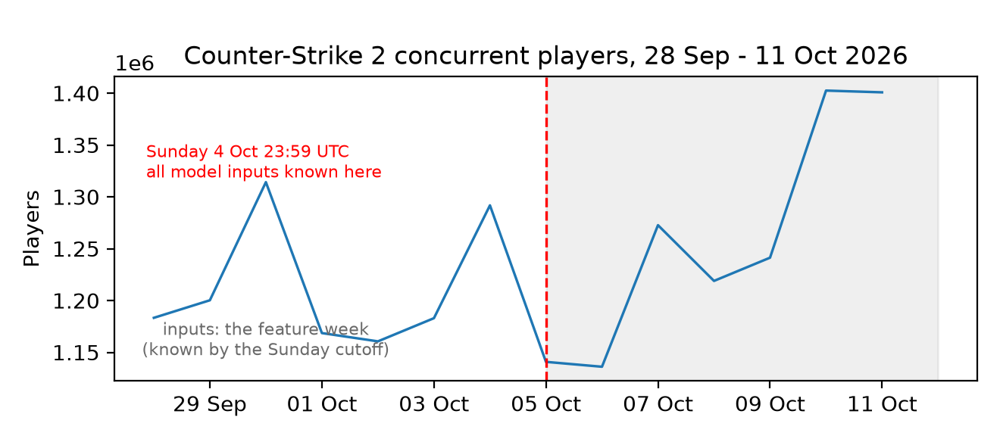
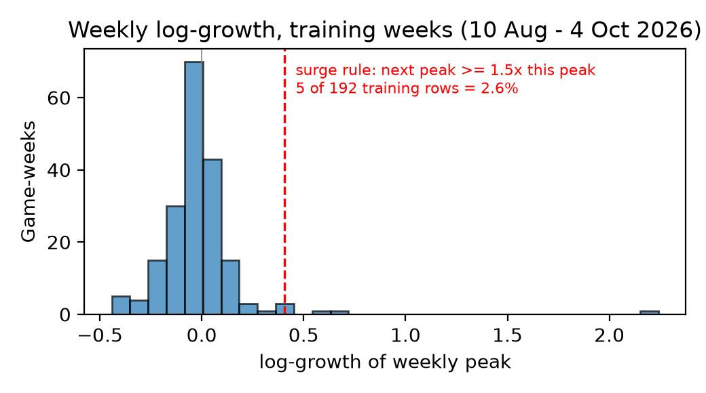
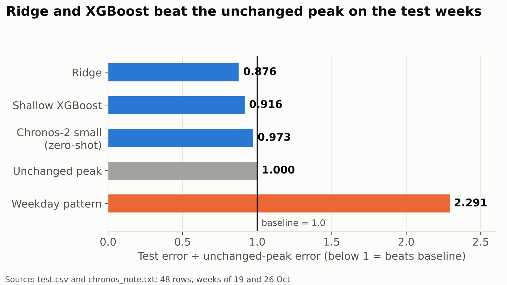
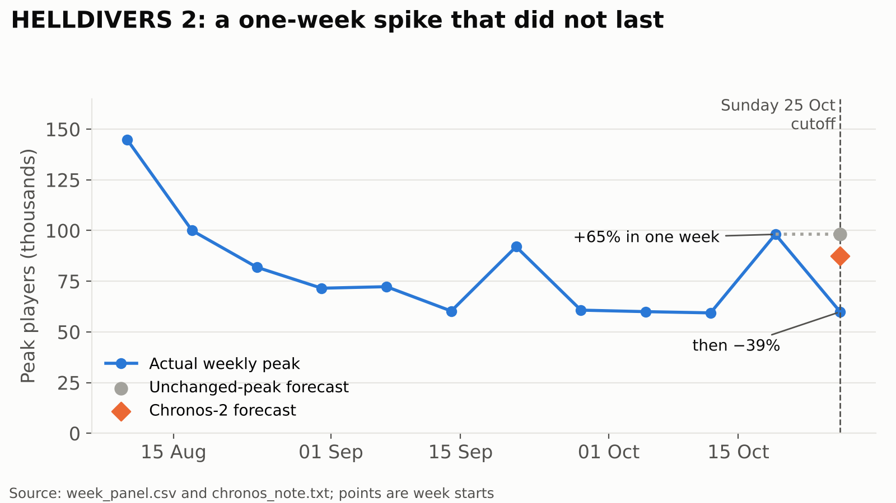
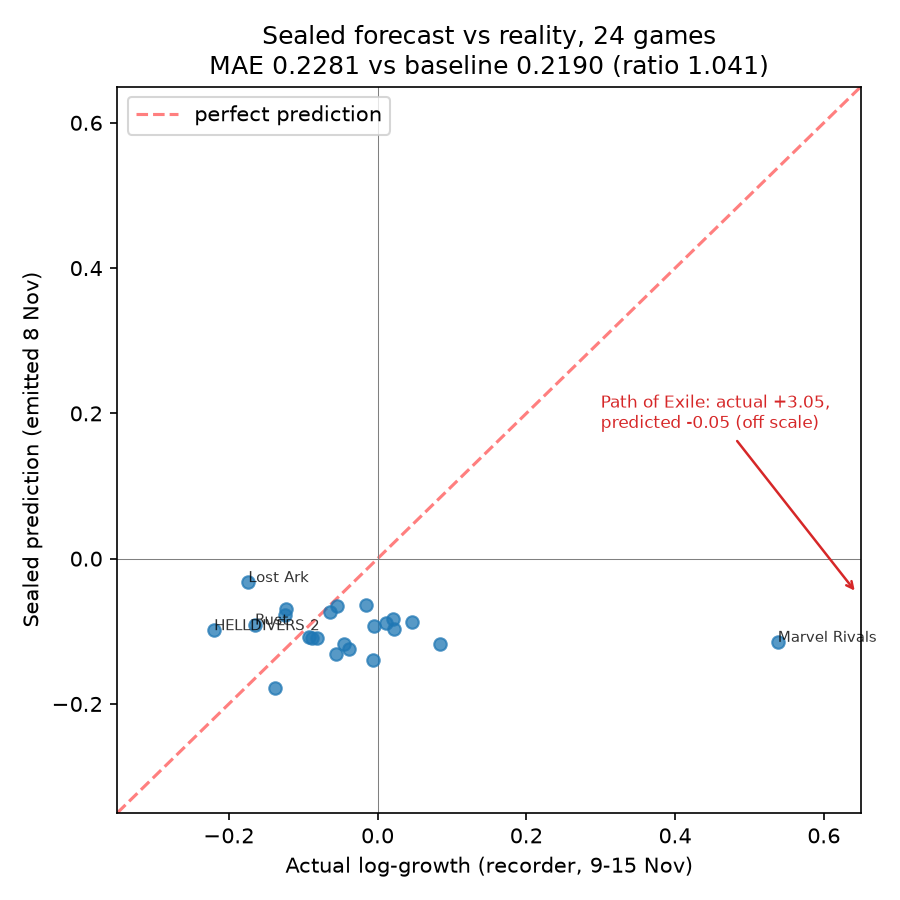

## One week, one line

{width=88%}

Everything the model may know stops at the red line: Sunday 23:59 UTC.

::: notes
Sienna opens. The chart is Counter-Strike 2 around the week of 28 September. The shaded week is what we predict; nothing right of the line is available.
:::

## The question (Soha)

For 24 games followed weekly from August to November 2026:

> Can momentum, calendar, peer, and news features predict next week's peak player growth better than assuming the peak will not change — **and does that edge survive a sealed forecast scored against data that did not exist when the prediction was made?**

- Target: `log(next week's peak) − log(this week's peak)`
- Baseline: predict 0 — free, and most weeks nearly right
- Metric: MAE of log-growth, and its ratio to the baseline (**< 1 wins**)

## The data (Sienna)

- **SteamCharts** histories, 24 games: monthly to 1 Aug, daily 9 Aug–6 Oct, hourly after — early peaks are daily maxima, a stated limit
- **Our own recorder**: hourly Steam API calls on two independent legs (Mac + GitHub Actions), ~5,500 rows each
- **Steam news API**: update posts per game-week
- **Refused, documented**: Twitch (API is live-only, no history to train on); Steam reviews (endpoint dead, probed); SullyGnome (no API, hand-read once)

## The target's shape (Sienna)

{width=70%}

- Surge rule: next peak $\ge$ 1.5× this peak **and** $\ge$ 2 robust deviations above the trailing median
- **5 of 192 training rows = 2.6%** — the center is predictable; the tail is the problem

## Calendar and peers (Sienna + Soha)

**Calendar** (descriptive, 8 training weeks): sale weeks averaged −0.011 log-growth vs −0.045 without; holiday weeks −0.011 vs −0.017. Associations, not causes.

**Peer momentum** (median growth of the *other* games in a genre group):

- Same week: games move with their group **65.5%** of the time
- Next week: **54.8%** — worse than always guessing "down" (62.5%)
- Strong for RPGs (24/28), below chance for shooters (12/42)

## The model ladder (Soha)

{width=64%}

- **Ridge wins the one-touch test: ratio 0.876** — chronological splits, validation for selection, test scored once
- Chronos-2 zero-shot: 0.973 — real transfer with no features, but a thin edge
- Ablation: dropping calendar (0.1413) or peers (0.1424) costs XGBoost its edge — **every feature family contributes**
- Ridge generalizes (0.112→0.126); XGBoost overfits (0.044→0.132) — full table in backup

::: notes
Soha. One sentence on Chronos: zero-shot, player history only, beats baseline by under 3% — thin edge, informative negative.
:::

## Case: HELLDIVERS 2 (Soha)

{width=72%}

Week of 19 Oct: own peak +65% week-over-week, peers slightly down. Next week: −39%. Peers and Chronos-2 had the **direction**, not the **size**.

## The seal (Destiny)

**8 November 2026, 15:59:30 UTC — before the week of 9–15 November existed:**

- Ridge refit on all 288 labeled weeks; 24 games, all predicted down (−0.03 to −0.18)
- Forecast file committed to GitHub (commit `4eeeebe`), never edited again
- Recorders kept logging hourly on two legs — the answer key
- Seal-night log named the wildcard: *Path of Exile expansion "Covens of Umbra", 13 Nov — invisible to Sunday features*

## The reveal (Destiny)

| Evaluation | Model MAE | Baseline MAE | Ratio |
|---|---:|---:|---:|
| Historical test (48 rows) | 0.1263 | 0.1440 | **0.876** |
| **Sealed live week (24 rows)** | 0.2281 | 0.2190 | **1.041** |

{width=46%}

## Anatomy of the miss (Destiny)

- **Path of Exile: +3.05 log-growth (~21×, 7.2k → 151.5k)** on the 13 Nov expansion — one row, over half the total error. Named in writing five days before it happened.
- Marvel Rivals +0.54 — a surge by our own rule
- Model still won 11 of 24 games — caught every large decline; lost on flat games (baseline's home turf) and 7 modest rises
- At 2.6% surge rate, a 24-game week had ~47% chance of $\ge$1 surge: **the draw was a coin flip**
- **Verified three ways**: recorder legs agree <10%; SteamCharts re-download within 2.4% on 23/24 (PoE: 151,488 vs 151,348)

## Limits and next step

**Limits:** 12 usable weeks, 24 games, 48 rows per split; daily samples early; peer groups hand-assigned; associations, not causes.

**Next step, directly from the miss:** expansion dates are *public calendar information* — PoE's was announced long before 8 Nov. A "known future content" feature is the obvious addition. Then: more seasons, quantile forecasts, a surge classifier.

## Division of labor (required slide)

| Member | Work | Evidence |
|---|---|---|
| **Destiny Sotonye** | Recorder (2 legs), panel, model ladder, evaluation, sealed forecast + scoring, repo | `collect/`, `model/`, `data/`, `decisions.md` |
| **Sienna (Tam Hoi Wing)** | Sales/holiday calendar, data quality, calendar case, calendar slides | `analysis/calendar*`, `report/02_*` |
| **Soha Ali** | Peer groups + momentum, model comparison figures, HELLDIVERS 2 case, peer slides | `analysis/peers*`, `report/01_*`, `report/figures/` |

All numbers traced to committed files; three hand-checks (SteamCharts pages, baseline errors, sealed file).

## Backup: validation detail

| Model | Train MAE | Val MAE | Test MAE |
|---|---:|---:|---:|
| Unchanged peak | 0.1141 | 0.0895 | 0.1440 |
| Weekday pattern | 0.1705 | 0.2255 | 0.3300 |
| Ridge | 0.1117 | 0.0980 | 0.1263 |
| XGBoost | 0.0442 | 0.1091 | 0.1319 |

Second test week's outcomes were 79–81 of 168 hourly samples complete at scoring (documented). Ridge for the live forecast was refit on all 288 labeled rows — standard post-evaluation practice, no leakage.

## Backup: reproducibility

- Repo: `github.com/destiny-brown/Steam-Analysis`, commit `6e576b2`
- Pipeline: `download_steamcharts.py --refresh` → `build_week_panel.py` → `train.py` → `run_chronos.py` → `forecast.py` → `score_live_week.py`
- MacBook M1, CPU only; Python 3.14.7, XGBoost 3.4.1, chronos-forecasting 2.3.2 (`autogluon/chronos-2-small`)
- Full live-week table: `model/results/live_week.csv`; session log: `decisions.md`
