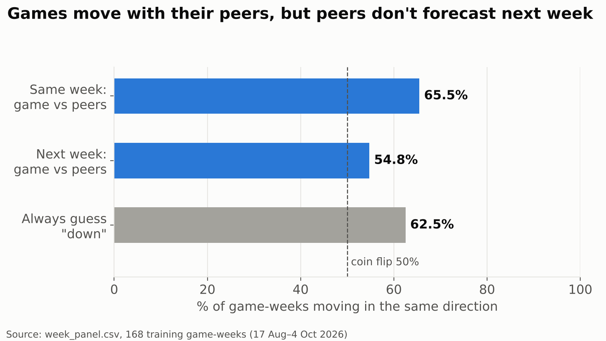
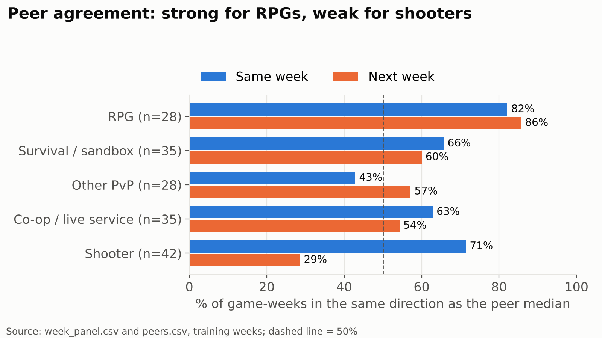
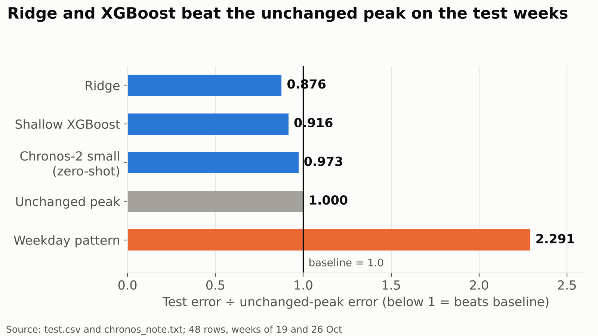
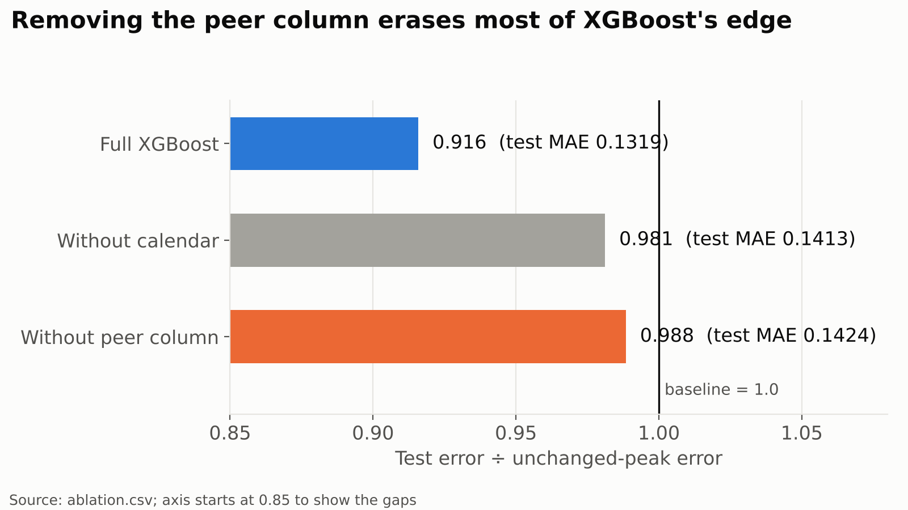
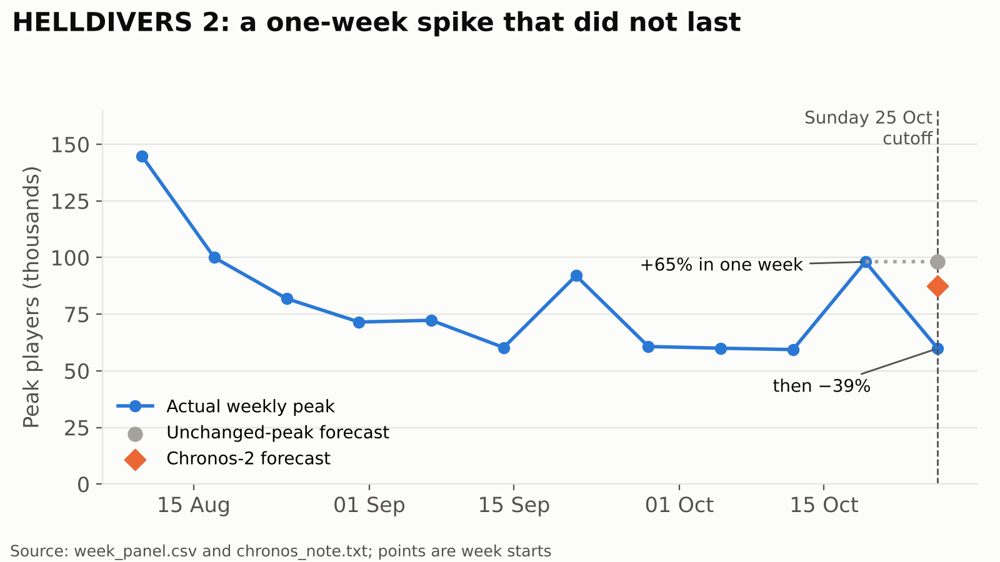

# Soha slides

Figures are in `report/figures/` and are redrawn from repository files only;
each one names its source file under the chart.

## 1. The question

For 24 games followed weekly from August to November 2026, can momentum,
calendar, peer, and news features predict next week's peak player growth
better than assuming the peak will not change — and does that edge survive a
sealed forecast scored against data that did not exist when the prediction
was made?

- Target: log(next week's peak) − log(this week's peak).
- Every input must be known by Sunday 23:59 UTC.

*Say:* Sienna's chart showed one week with the Sunday cutoff marked. Our
question is whether anything known at that line tells us where the peak goes
next.

## 2. Why the split is by time

- A random 80/20 split would train on later weeks of the same game and test
  on earlier ones: the model would learn from the future it predicts.
- So: train on weeks to 4 October, validate 5–18 October, test 19 October–1
  November once, then a live forecast sealed on 8 November.
- Training R² is not the headline: extra features raise it without helping
  unseen weeks.

## 3. The comparison: an unchanged peak

- Predict log growth = 0, meaning next week's peak equals this week's.
- Most peaks barely move, so this is hard to beat and costs nothing.
- Every model reports its error divided by this one: below 1 beats it.
- Hand check: five games, week of 21 September, errors 0.0989, 0.0889,
  0.0462, 0.0197, 0.0090; mean 0.0525.

## 4. Peer momentum

- Five groups a player would recognise: shooter, co-op/live service,
  survival/sandbox, RPG, other PvP.
- Peer momentum = median week-on-week growth of the *other* games in the
  group.
- Training weeks: same direction as peers in the same week **110 of 168
  (65.5%)**.
- As a forecast of next week: **92 of 168 (54.8%)**, worse than always
  guessing "down" (62.5%).

*Say:* Games do move with their genre, but on the training weeks that alone
did not forecast the next week. RPGs are the exception; shooters go the other
way.

## 5. Model ladder and ablation (historical test, 48 rows)

| Model | Test MAE | Ratio |
|---|---|---|
| Unchanged peak | 0.1440 | 1.000 |
| Weekday pattern | 0.3300 | 2.291 |
| Ridge | 0.1263 | 0.876 |
| Shallow XGBoost | 0.1319 | 0.916 |
| Chronos-2 small, zero-shot | 0.1401 | 0.973 |

Ablation, from `ablation.csv`: full XGBoost 0.1319, without calendar 0.1413,
without the peer column 0.1424. On the test weeks, removing the peer column
took away most of XGBoost's edge; on validation it made almost no difference.

## 6. Case: HELLDIVERS 2, week of 19–25 October

- Known on Sunday: own peak up about 65% (`wow_growth` +0.50); peers slightly
  down (`peer_median_growth` −0.04).
- Next week: peak fell about 39% (`log_growth` −0.49).
- Unchanged-peak error 0.4936, over three times the pooled 0.1440.
- Chronos-2 predicted an 11% fall (error 0.3773).
- The peers and Chronos had the direction, not the size.

## 7. Live week, 9–15 November

*[Filled on 16 November from `model/results/live_week.csv` only.]*

## 8. Limits

- About twelve usable weeks and 24 games; 48 rows per test split.
- Training weeks are daily samples, not the true hourly peak.
- Twitch left out: no history the model can train on. Steam news is the
  attention signal; SullyGnome read by hand for at most one example.
- Momentum columns come from the same player series and are correlated.
- The test was scored before its second outcome week was complete.
- No claim that a sale, a news post or a peer game caused a surge.
